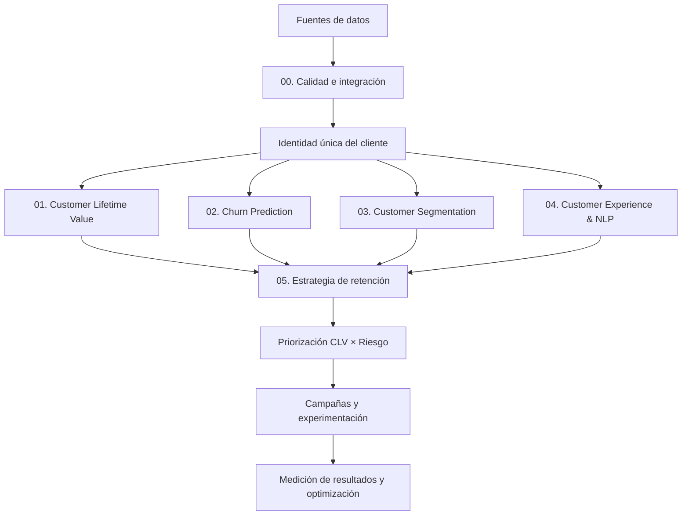

# 🛡️ Sistema de Inteligencia de Clientes y Retención — Caso Seguros

### De la analítica descriptiva a la toma de decisiones basada en datos

**Proyecto de Data Science | Customer Intelligence | Machine Learning | Customer Lifetime Value | Churn Prediction | Customer Segmentation | NLP | Experimentación**

---

## 📌 1. Descripción del proyecto

Este proyecto desarrolla un sistema integral de inteligencia de clientes para una compañía aseguradora, utilizando técnicas de ciencia de datos y analítica avanzada para comprender el valor económico de los asegurados, anticipar su probabilidad de abandono y optimizar las estrategias de retención.

La solución integra diferentes fuentes de información comercial, transaccional y de experiencia del cliente para construir una visión unificada de cada persona y transformar los datos en decisiones estratégicas.

El proyecto aborda una pregunta central:

> ¿Cómo puede una aseguradora identificar a sus clientes de mayor valor, anticipar el riesgo de fuga y asignar eficientemente sus recursos de retención para maximizar el valor económico de su cartera?

Para responderla, se desarrolla un pipeline analítico compuesto por seis módulos:

1. **Data Quality & Customer Identity Resolution:** auditoría de calidad, integración de fuentes y construcción de una identidad única del cliente.
2. **Customer Lifetime Value (CLV):** estimación del valor económico histórico y proyectado de los clientes.
3. **Churn Prediction:** identificación de clientes con mayor probabilidad de abandonar la compañía.
4. **Customer Segmentation:** identificación de perfiles de clientes mediante algoritmos de clustering.
5. **Customer Experience Analytics:** análisis de sentimientos y modelado de temas sobre comentarios de clientes.
6. **Retention Campaign Optimization:** evaluación de intervenciones comerciales, priorización de clientes y diseño de experimentos para medir el impacto incremental de las campañas.

El resultado es una propuesta de inteligencia de clientes que conecta valor económico, comportamiento, experiencia y riesgo de fuga para orientar las decisiones de mercadeo y retención.

---

## 🎯 2. Objetivos

### Objetivo general

Diseñar un sistema de inteligencia de clientes basado en ciencia de datos que permita estimar el valor económico de los asegurados, predecir su riesgo de fuga, identificar segmentos estratégicos y optimizar las intervenciones de retención mediante evidencia estadística y económica.

### Objetivos específicos

- Integrar y depurar fuentes de información para construir una base unificada de clientes.
- Estimar el Customer Lifetime Value histórico y proyectado.
- Desarrollar modelos de clasificación para anticipar la probabilidad de fuga.
- Identificar segmentos de clientes con características y necesidades diferenciadas.
- Analizar comentarios y señales de experiencia para detectar oportunidades de mejora.
- Evaluar el efecto de las campañas de retención mediante metodologías experimentales.
- Construir una estrategia de priorización que combine valor económico y riesgo de fuga.
- Proponer indicadores y mecanismos de seguimiento para medir la efectividad de las intervenciones.

---

## 🏗️ 3. Arquitectura del proyecto

El proyecto está organizado en seis notebooks secuenciales, cada uno correspondiente a una etapa del proceso analítico.

| Notebook | Módulo | Objetivo |
|---|---|---|
| `00_calidad_datos.ipynb` | Data Quality | Auditoría, integración y resolución de identidades. |
| `01_valor_cliente.ipynb` | Customer Lifetime Value | Estimación y validación del valor económico. |
| `02_riesgo_fuga.ipynb` | Churn Prediction | Predicción de la probabilidad de abandono. |
| `03_segmentacion.ipynb` | Customer Segmentation | Identificación de grupos estratégicos. |
| `04_analisis_texto.ipynb` | NLP & Customer Experience | Análisis de sentimientos y modelado de temas. |
| `05_campana_retencion.ipynb` | Retention Analytics | Evaluación experimental y optimización de campañas. |

### Flujo analítico



---

## 📊 4. Desarrollo metodológico

### 4.1. Data Quality & Customer Identity Resolution

**Notebook:** `00_calidad_datos.ipynb`

Se realiza una auditoría de calidad sobre doce fuentes de información relacionadas con clientes, pólizas, recaudos, siniestros, experiencia y actividad comercial.

Principales actividades:

- Análisis de dimensiones, tipos de datos y valores faltantes.
- Evaluación de integridad referencial.
- Identificación de registros duplicados.
- Construcción de un identificador canónico por persona.
- Definición de la población de clientes activos al 31 de diciembre de 2025.
- Estandarización y tratamiento de variables.
- Construcción de una tabla de correspondencia entre identificadores.

**Hallazgo relevante:**

Se identificaron 102.764 registros en el CRM correspondientes a 95.353 personas únicas, con 7.411 registros adicionales asociados a identidades duplicadas.

Se construyó un identificador canónico para consolidar la información de cada persona y facilitar su análisis transversal.

### 4.2. Customer Lifetime Value (CLV)

**Notebook:** `01_valor_cliente.ipynb`

Se desarrolla un modelo de valoración económica para estimar la contribución de los clientes a la rentabilidad de la compañía.

Se implementan dos enfoques:

- **CLV histórico:** estimación del valor económico acumulado a partir de los recaudos, siniestros y costos asociados.
- **CLV proyectado:** estimación del valor futuro mediante un horizonte de proyección de tres años, tasas de cancelación por ramo y descuento financiero.

Principales componentes metodológicos:

- Construcción de flujos económicos por cliente.
- Cálculo de márgenes por ramo.
- Estimación de tasas de cancelación.
- Descuento de flujos futuros.
- Validación out-of-sample.
- Análisis de sensibilidad.
- Evaluación de la incertidumbre.
- Identificación de factores asociados al valor económico.

**Resultados destacados:**

| Indicador | Resultado |
|---|---:|
| Clientes analizados | 35.130 |
| CLV histórico mediano | ≈ $4,49 millones COP |
| CLV histórico medio | ≈ $15,6 millones COP |
| CLV proyectado mediano (escenario base) | ≈ $2,5 millones COP |
| Correlación Spearman CLV histórico | 0,8376 |
| Correlación Spearman CLV proyectado | 0,6591 |

La diversificación de productos presenta una asociación positiva con el valor histórico del cliente.

Los resultados permiten identificar oportunidades de venta cruzada y orientar estrategias de fidelización hacia clientes con mayor contribución económica potencial.

### 4.3. Churn Prediction

**Notebook:** `02_riesgo_fuga.ipynb`

Se desarrolla un modelo predictivo para estimar la probabilidad de abandono de los clientes y anticipar posibles cancelaciones.

El proceso contempla:

- Definición de la variable objetivo.
- Construcción de variables predictoras.
- Preparación de datos.
- Separación temporal de entrenamiento y evaluación.
- Entrenamiento y comparación de modelos.
- Evaluación de desempeño.
- Interpretabilidad mediante SHAP.
- Construcción de probabilidades individuales de fuga.

Se utilizan modelos de clasificación, incluyendo regresión logística y XGBoost.

**Métricas de evaluación destacadas:**

| Métrica | XGBoost |
|---|---:|
| ROC-AUC | 0,9735 |
| PR-AUC | 0,7799 |

La evaluación contempla un holdout temporal que comprende diciembre de 2024 y el primer semestre de 2025.

Entre las variables relevantes identificadas mediante SHAP se encuentran:

- Porcentaje de pólizas canceladas.
- Número de pólizas próximas a vencer.
- Número de pólizas activas.

El resultado es un score individual de probabilidad de fuga que permite ordenar los clientes según su nivel de riesgo.

### 4.4. Customer Segmentation

**Notebook:** `03_segmentacion.ipynb`

Se implementa un modelo de clustering para identificar perfiles de clientes con características diferenciadas.

Se utiliza K-Means, acompañado de procedimientos de estandarización, selección de variables y evaluación de la estabilidad de los segmentos.

Se identifican cinco grupos:

| Segmento | Clientes |
|---|---:|
| Nuevos de bajo valor | 13.578 |
| Estables medios | 8.820 |
| Champions | 3.296 |
| Fuga inminente | 3.323 |
| En riesgo medio | 6.113 |

**Métricas de evaluación:**

- Silhouette Score: 0,2981.
- Estabilidad Jaccard: 0,9875.

La segmentación permite identificar diferentes perfiles y orientar estrategias comerciales según las características de cada grupo.

Se utiliza como herramienta de caracterización y priorización, no como una clasificación determinística del comportamiento futuro.

### 4.5. Customer Experience Analytics & NLP

**Notebook:** `04_analisis_texto.ipynb`

Se desarrolla un proceso de análisis de comentarios de clientes para identificar patrones de experiencia, temas recurrentes y señales de insatisfacción.

**Datos analizados:**

- 99.775 encuestas disponibles.
- 76.581 comentarios reales procesados.
- Período de análisis: enero de 2020 a diciembre de 2025.

**Metodología:**

1. Limpieza y normalización de texto.
2. Eliminación de URLs, emojis y términos irrelevantes.
3. Normalización de vocabulario.
4. Construcción de un indicador híbrido de sentimiento.
5. Modelado de temas mediante Latent Dirichlet Allocation (LDA).
6. Construcción de un puntaje de prioridad.

El análisis de sentimiento combina NPS, satisfacción y un léxico de términos positivos y negativos.

**Distribución de sentimientos:**

| Sentimiento | Comentarios | Porcentaje |
|---|---:|---:|
| Positivo | 48.045 | 62,7 % |
| Negativo | 14.541 | 19,0 % |
| Neutro | 13.995 | 18,3 % |

Se identifican ocho temas principales:

- Propuesta comercial.
- Cancelación y no renovación.
- Experiencia positiva.
- Renovación y siniestros.
- Aplicaciones y canales digitales.
- Reembolsos.
- Cobro y facturación.
- Autorización y cobertura.

El resultado permite priorizar oportunidades de mejora en los procesos que afectan la experiencia y potencialmente la permanencia de los clientes.

### 4.6. Retention Campaign Optimization

**Notebook:** `05_campana_retencion.ipynb`

Se evalúa una campaña de retención implementada durante 2025 y se desarrolla una propuesta de priorización de clientes para 2026.

El análisis incorpora:

- Evaluación del diseño experimental.
- Identificación de sesgos de selección.
- Comparación de tratamiento y control.
- Estimación del Average Treatment Effect (ATE).
- Intervalos de confianza.
- Pruebas de significancia estadística.
- Evaluación de costos por intervención.
- Priorización mediante CLV y riesgo de fuga.

**Resultado experimental principal:**

| Indicador | Resultado |
|---|---:|
| Renovación del tratamiento | 94,37 % |
| Renovación del control | 93,69 % |
| ATE | +0,68 puntos porcentuales |
| Intervalo de confianza 95 % | [-0,24; +1,63] pp |
| Valor p | 0,1635 |

El piloto no demuestra un efecto estadísticamente significativo de la intervención sobre la renovación.

Este resultado es relevante para evitar atribuir causalidad a diferencias observacionales entre clientes contactados y no contactados.

**Estrategia de priorización:**

Se propone integrar el valor económico y la probabilidad de fuga mediante un indicador de prioridad:

`score_prioridad = clv_proyectado × probabilidad_fuga`

La asignación de intervenciones contempla:

- Llamadas de asesores.
- Beneficios adicionales.
- Descuentos de renovación.

La estrategia busca concentrar los recursos de retención en clientes donde exista una mayor oportunidad de preservar valor económico.

También se plantea un diseño experimental para 2026 con grupos de tratamiento y control que permita medir el impacto incremental de las acciones.

---

## 📈 5. Principales resultados y valor de negocio

El proyecto permite desarrollar una visión integral del cliente y habilitar decisiones basadas en cinco capacidades:

| Capacidad | Aplicación empresarial |
|---|---|
| Conocer | Consolidación de identidades y calidad de información. |
| Valorar | Identificación de clientes según contribución económica. |
| Anticipar | Detección temprana de riesgo de fuga. |
| Diferenciar | Estrategias comerciales por segmento y experiencia. |
| Actuar | Priorización de campañas y evaluación experimental. |

### Propuesta de valor

El sistema busca pasar de estrategias masivas de retención a una gestión diferenciada que considere simultáneamente:

- Valor económico del cliente.
- Probabilidad de fuga.
- Características del segmento.
- Señales de experiencia.
- Costo de la intervención.
- Efectividad incremental de la acción.

**Importante:** los resultados predictivos y las asociaciones estadísticas no representan automáticamente ingresos incrementales. El impacto financiero de las campañas debe validarse mediante experimentación y seguimiento de resultados reales.

---

## 🗂️ 6. Estructura del repositorio

```text
caso-seguros-ds/
│
├── notebooks/
│   ├── 00_calidad_datos.ipynb
│   ├── 01_valor_cliente.ipynb
│   ├── 02_riesgo_fuga.ipynb
│   ├── 03_segmentacion.ipynb
│   ├── 04_analisis_texto.ipynb
│   └── 05_campana_retencion.ipynb
│
├── outputs/
│   ├── comentarios_analizados.csv
│   ├── contactos_2026.csv
│   ├── riesgo_fuga.csv
│   ├── segmentos.csv
│   ├── tabla_correspondencia.csv
│   └── valor_cliente.csv
│
├── data/                  # Datos fuente (no incluidos)
│
├── figures/               # Visualizaciones generadas
│
├── requirements.txt
├── run_all.py
├── .gitignore
└── README.md
```

Los directorios `data/` y `figures/` son utilizados o referenciados por los notebooks, pero no están incluidos en la distribución actual del repositorio.

---

## ⚙️ 7. Tecnologías y herramientas

| Categoría | Herramientas |
|---|---|
| Lenguaje | Python |
| Manipulación de datos | Pandas, NumPy |
| Machine Learning | Scikit-learn, XGBoost |
| Modelos de clustering | K-Means |
| Interpretabilidad | SHAP |
| Procesamiento de texto | Scikit-learn, NLP |
| Modelado de temas | Latent Dirichlet Allocation |
| Estadística | SciPy |
| Visualización | Matplotlib, Seaborn |
| Desarrollo | Jupyter Notebook, VS Code |
| Control de versiones | Git, GitHub |

---

## 🚀 8. Instalación y ejecución

### Requisitos previos

- Python.
- Git.
- Jupyter Notebook o JupyterLab.
- Acceso a los archivos fuente del proyecto.

### 1. Clonar el repositorio

```bash
git clone https://github.com/marianarada/caso-seguros-ds.git

cd caso-seguros-ds
```

### 2. Crear un entorno virtual

```bash
python -m venv .venv
```

Activar el entorno en Windows:

```bash
.venv\Scripts\activate
```

Activar el entorno en macOS/Linux:

```bash
source .venv/bin/activate
```

### 3. Instalar dependencias

```bash
pip install -r requirements.txt
```

### 4. Incorporar los datos fuente

Crear la carpeta `data/` y ubicar allí los archivos originales requeridos por los notebooks.

Los archivos deben conservar los nombres y las estructuras esperadas por cada módulo.

Por razones de privacidad, los datos originales no se distribuyen en este repositorio.

### 5. Ejecutar los notebooks

Iniciar Jupyter:

```bash
jupyter lab
```

Ejecutar los notebooks en el siguiente orden:

1. `00_calidad_datos.ipynb`
2. `01_valor_cliente.ipynb`
3. `02_riesgo_fuga.ipynb`
4. `03_segmentacion.ipynb`
5. `04_analisis_texto.ipynb`
6. `05_campana_retencion.ipynb`

**Nota:** los notebooks utilizan rutas relativas hacia `data/` y `outputs/`. Se recomienda ejecutarlos desde la estructura original del proyecto y en el orden indicado, ya que algunos módulos dependen de resultados generados previamente.

---

## 📦 9. Archivos de salida

Los principales resultados del pipeline se almacenan en `outputs/`.

| Archivo | Descripción |
|---|---|
| `tabla_correspondencia.csv` | Relación entre identificadores originales y canónicos. |
| `valor_cliente.csv` | Estimaciones de valor económico por cliente. |
| `riesgo_fuga.csv` | Probabilidades individuales de fuga. |
| `segmentos.csv` | Asignación de clientes a segmentos. |
| `comentarios_analizados.csv` | Resultados de sentimiento, temas y prioridad. |
| `contactos_2026.csv` | Clientes priorizados y acciones recomendadas para retención. |

Los archivos pueden utilizarse como insumos para análisis posteriores, tableros de BI y procesos de seguimiento comercial.

---

## ⚠️ 10. Supuestos y limitaciones

Para interpretar correctamente los resultados se deben considerar las siguientes limitaciones:

**Calidad de datos**
- Existen valores faltantes en diferentes fuentes.
- La consolidación de identidades depende de la información documental disponible.
- Algunas relaciones entre fuentes no permiten una identificación individual completa.

**Customer Lifetime Value**
- Las estimaciones proyectadas dependen del horizonte temporal, la tasa de descuento y los supuestos de cancelación y rentabilidad por ramo.
- El valor histórico no representa necesariamente el valor futuro.
- Las proyecciones deben actualizarse con nuevos períodos de información.

**Churn Prediction**
- El desempeño predictivo depende de la estabilidad de los patrones históricos.
- Los cambios comerciales y operativos pueden afectar la capacidad de generalización.
- Las probabilidades de fuga no implican que la intervención comercial evite automáticamente la cancelación.

**Customer Segmentation**
- Los clusters representan patrones estadísticos y no categorías inmutables.
- La separación entre segmentos es moderada y debe complementarse con validación de negocio.

**NLP**
- El sentimiento utiliza un enfoque híbrido basado principalmente en NPS y satisfacción.
- La clasificación temática depende del vocabulario y de la configuración del modelo LDA.
- Los resultados no equivalen a una evaluación humana independiente de cada comentario.

**Campañas de retención**
- El piloto analizado no demuestra un efecto estadísticamente significativo sobre la renovación.
- Las comparaciones observacionales pueden presentar sesgo de selección.
- Las recomendaciones de inversión deben validarse mediante experimentos controlados.

---

## 🔐 11. Privacidad y manejo de información

Este proyecto trabaja con información relacionada con clientes, pólizas, transacciones y experiencia.

Por esta razón:

- Los archivos originales no deben publicarse sin autorización.
- Los identificadores personales deben protegerse.
- Los resultados compartidos deben agregarse o anonimizarse.
- Las credenciales y datos sensibles no deben almacenarse en GitHub.
- Los archivos privados deben excluirse mediante `.gitignore`.

El repositorio debe contener únicamente código, documentación y resultados cuya publicación esté autorizada.

---

## 🔮 12. Próximas oportunidades de desarrollo

Las siguientes iniciativas permitirían evolucionar el proyecto hacia un sistema operativo de inteligencia de clientes:

- Automatización periódica de la actualización de datos y predicciones.
- Monitoreo de calidad de datos y desempeño de modelos.
- Seguimiento de drift en variables y probabilidades de fuga.
- Integración de resultados en Power BI.
- Desarrollo de un dashboard de priorización comercial.
- Implementación de experimentos A/B recurrentes.
- Seguimiento de CLV y rentabilidad incremental de campañas.
- Versionamiento de modelos y trazabilidad de experimentos.
- Automatización del pipeline y despliegue de modelos.

---

## 👩‍💻 13. Autora

**Mariana Rada Espitia**

Economista | Especialista en Ciencia de Datos e Inteligencia Artificial

Intereses profesionales:

- Data Science & Machine Learning.
- Business Intelligence.
- Customer Analytics.
- Predictive Modeling.
- Marketing Analytics.
- Data-driven Decision Making.

GitHub: [@marianarada](https://github.com/marianarada)

---

*Proyecto desarrollado con fines de análisis de datos, modelamiento predictivo e inteligencia de clientes. Las recomendaciones de negocio son propuestas analíticas y deben validarse con información operativa y financiera antes de su implementación.*